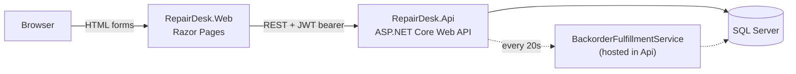

# RepairDesk

[](https://github.com/edu-tech220/repairdesk/actions/workflows/ci.yml)


Electronics warranty and RMA (Return Merchandise Authorization) management platform.
A customer submits a claim by serial number, an agent walks it through diagnosis,
and the case resolves as a repair, a replacement unit, or a prorated refund —
all while stock and case updates stay consistent under concurrent access.

## What it solves

A warranty desk needs to answer three questions for every claim: *is this device
still covered*, *what happens to it next*, and *can two agents touch the same
case or the same stock count at once without corrupting either one*. RepairDesk
answers all three with a small, explicit state machine instead of a flat
`status` string, and with optimistic concurrency instead of locks.

## Business rules

- **Automatic warranty check.** A claim is looked up by serial number; if
  `now > WarrantyExpiresOn` it's rejected immediately with the expiration date
  as the reason, no agent involved.
- **Case state machine.** `UnderReview → AwaitingReturn → Diagnosing → Resolved → Closed`,
  with `UnderReview → Rejected` and a `Diagnosing → Backordered → Resolved`
  branch when a replacement is requested but out of stock. Every transition is
  validated against the case's current status — an agent can't resolve a case
  that hasn't been received yet.
- **Tier-aware prorated refunds.** A refund resolution pays out
  `price × max(floor, remaining-warranty-fraction)`, where the floor is a
  goodwill minimum: 10% for Standard tier, 50% for Extended tier. A claim
  filed the day after purchase gets close to a full refund; one filed the day
  before expiration still gets the floor instead of a token amount.
- **Stock reservation with automatic backorder recovery.** A Replace
  resolution reserves one unit from inventory under optimistic concurrency
  with a short retry loop. If stock is at zero, the case moves to
  `Backordered` instead of failing, and a `BackgroundService` retries every
  20 seconds so the case resolves itself as soon as the product is restocked.
- **Optimistic concurrency on every case transition.** Each case carries a
  manually-rotated `RowVersion` token exposed as an ETag. Every state-changing
  endpoint requires an `If-Match` header; a stale or missing one returns
  `412 Precondition Failed` instead of silently clobbering someone else's
  change. The token is rotated by the app itself (not DB-generated) so the
  same logic works on both SQL Server and SQLite.
- **Rate-limited public intake.** Claim submission is anonymous (customers
  don't have accounts) but capped at 5 requests/minute per client via
  ASP.NET Core's built-in rate limiter.
- **Paginated, filterable case list.** Agents list cases by status and serial
  number search with server-side paging instead of loading every case.

## Architecture



`RepairDesk.Web` and `RepairDesk.Api` are two separately deployable ASP.NET
Core apps with no shared assembly — the frontend only knows the API's JSON
contract, called through a typed `HttpClient` (`RepairDeskApiClient`). The
browser never talks to the API directly: the JWT issued at login is stashed
inside the Web app's auth cookie and reattached to outgoing API calls by a
`DelegatingHandler`, so the user-facing session stays a plain cookie while the
API still only understands bearer tokens.

## Technical decisions

- **No shared library between Web and Api.** Each project defines its own
  DTOs. It's some duplication, but it keeps the two deployables honestly
  independent — a contract change is felt immediately instead of silently
  propagating through a shared package reference.
- **Manual RowVersion instead of SQL Server's native `rowversion` type.**
  SQL Server auto-increments a `rowversion` column at the engine level, but
  SQLite (used in tests) has no equivalent. `RepairDeskDbContext.SaveChanges`
  rotates a `byte[]` concurrency token itself on every insert/update, so the
  exact same optimistic-concurrency code path is exercised by the test suite
  as by the SQL Server deployment.
- **Custom JWT + PBKDF2 auth instead of ASP.NET Core Identity.** There's no
  self-registration flow and only two roles (Agent, Admin), so Identity's
  surface area (external logins, email confirmation, lockout policies) would
  be pure overhead. A `PasswordHasher` using `Rfc2898DeriveBytes.Pbkdf2` and a
  hand-rolled `JwtTokenService` cover exactly what's needed.
- **A polling `BackgroundService` instead of a message queue for backorders.**
  The volume of backordered cases in a warranty desk is low and a 20-second
  worst-case delay to notice a restock is a fine trade for not adding
  infrastructure (a broker, outbox table) to a single-instance demo app.
- **`IExceptionHandler` + `ProblemDetails` for error mapping.** Domain
  exceptions (`NotFoundException`, `InvalidCaseTransitionException`,
  `ConcurrencyConflictException`) are mapped centrally to the right HTTP
  status instead of every controller action carrying its own try/catch.

## Endpoints

| Method | Route | Auth | Notes |
| --- | --- | --- | --- |
| POST | `/api/auth/login` | Anonymous | Returns a JWT |
| POST | `/api/rma-cases` | Anonymous, rate-limited | Submit a claim by serial number |
| GET | `/api/rma-cases` | Agent, Admin | Paginated, filter by `status`/`search` |
| GET | `/api/rma-cases/{id}` | Agent, Admin | Returns an `ETag` header |
| GET | `/api/rma-cases/{id}/history` | Agent, Admin | Status-change timeline |
| POST | `/api/rma-cases/{id}/approve` | Agent, Admin | Requires `If-Match` |
| POST | `/api/rma-cases/{id}/reject` | Agent, Admin | Requires `If-Match` + reason |
| POST | `/api/rma-cases/{id}/receive` | Agent, Admin | Requires `If-Match` |
| POST | `/api/rma-cases/{id}/resolve` | Agent, Admin | Requires `If-Match` + resolution type |
| POST | `/api/rma-cases/{id}/close` | Agent, Admin | Requires `If-Match` |
| GET | `/api/products` | Agent, Admin | Includes current stock |
| POST | `/api/products` | Admin | Creates product + initial stock |
| GET | `/api/inventory` | Agent, Admin | Same as products, inventory-focused view |
| POST | `/api/inventory/{productId}/restock` | Admin | Adds stock; backorders fulfill within 20s |
| GET | `/api/devices/{serialNumber}` | Agent, Admin | Registered device lookup |
| POST | `/api/devices` | Agent, Admin | Register a purchased device |

## Running it

### With Docker Compose

```bash
docker compose up --build
```

- API: http://localhost:8080/swagger
- Web: http://localhost:8081

### With `dotnet run`

Start a local SQL Server (skip if you already have one):

```bash
docker run -e "ACCEPT_EULA=Y" -e "MSSQL_SA_PASSWORD=Your_password123" -p 1433:1433 mcr.microsoft.com/mssql/server:2022-latest
```

Then, in two terminals:

```bash
dotnet run --project RepairDesk.Api   # http://localhost:5152/swagger
dotnet run --project RepairDesk.Web   # http://localhost:5103
```

`RepairDesk.Web/appsettings.json` already points `Api:BaseUrl` at the API's
`launchSettings.json` HTTP port, so both run with no extra configuration.

### Demo admin account

Seeded automatically on first run:

- Username: `admin`
- Password: `Admin#12345`

## Testing

```bash
dotnet test
```

The whole suite (unit + integration) runs against an in-memory SQLite
database through a `WebApplicationFactory`, with no SQL Server or Docker
required. Integration tests cover the full case state machine for every
resolution type, warranty-expiration rejection, optimistic-concurrency
conflicts (412), pagination, and role-based authorization (401/403).

## Project structure

```
RepairDesk.Api/        ASP.NET Core Web API: domain, EF Core, services, controllers
RepairDesk.Web/        ASP.NET Core Razor Pages frontend
RepairDesk.Api.Tests/  xUnit unit + integration tests
```
